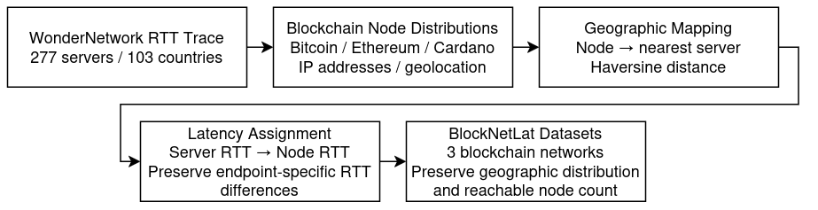
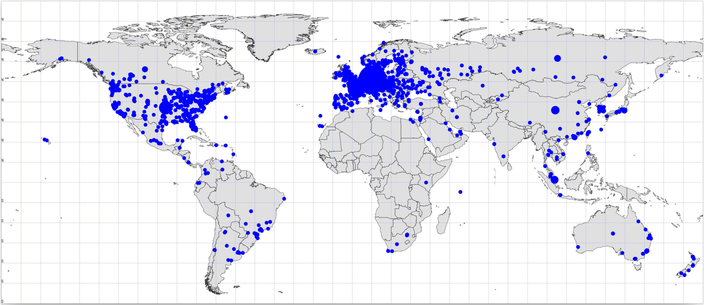
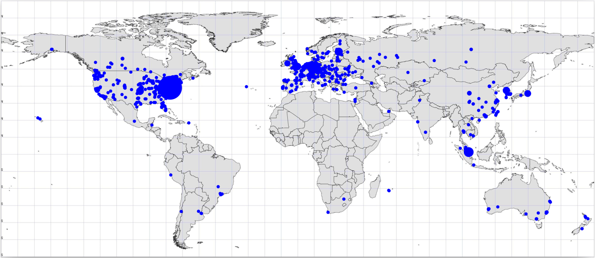
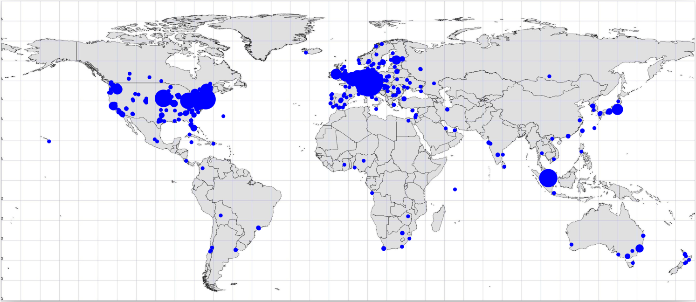

# BlockNetLat: From Global Server Measurements to Geographically-Informed Peer-to-Peer Blockchain Latency Datasets

BlockNetLat is a methodology and a collection of geographically informed latency datasets for blockchain Peer-to-Peer (P2P) networks.

The project provides realistic and reproducible Round-Trip Time (RTT) datasets for three major blockchain networks: **Bitcoin**, **Ethereum**, and **Cardano**.

The datasets are constructed by combining global server-to-server latency measurements from WonderNetwork with the observed geographic distributions of publicly reachable blockchain infrastructure nodes.

## Methodology Overview

BlockNetLat transforms infrastructure-level Internet latency measurements into geographically informed blockchain P2P latency datasets.

<p align="center">
  
  <br>
  <em>Pipeline of the BlockNetLat Methodology</em>
</p>

The methodology consists of the following main steps:

1. Global Latency Measurements: Obtain RTT measurements between 277 geographically distributed WonderNetwork servers across 103 countries.
2. Blockchain Node Geographic Distribution: Collect geographic information about publicly reachable infrastructure nodes from the Bitcoin, Ethereum, and Cardano networks.
3. Geographic Mapping: Associate each blockchain node with the geographically closest WonderNetwork server using the Haversine formula.
4. RTT Assignment: Derive node-to-node RTT measurements directly from the corresponding WonderNetwork server-to-server measurements, preserving differences between independently collected RTT values for opposite endpoint orderings.
5. Dataset Construction: Generate blockchain-specific RTT matrices while preserving the observed geographic distribution and the number of reachable infrastructure nodes.

When multiple blockchain nodes are mapped to the same WonderNetwork server, the minimum observed RTT in the WonderNetwork dataset is assigned to the corresponding node pairs.

For a detailed description of the methodology, assumptions, and processing pipeline, please refer to the research paper.

## Geographic Distributions

The following figures illustrate the geographic distributions of publicly reachable infrastructure nodes in the three blockchain networks, as observed during the data collection process.

<p align="center">
  
  <br>
  <em>Bitcoin network geographic distribution</em>
</p>

<br>

<p align="center">
  
  <br>
  <em>Ethereum network geographic distribution</em>
</p>

<br>

<p align="center">
  
  <br>
  <em>Cardano network geographic distribution</em>
</p>

## Datasets

BlockNetLat provides three blockchain-specific latency datasets:

| Blockchain | Number of Nodes | Dataset File |
|:---:|:---:|:---:|
| Bitcoin | 8,000 | [`bitcoin.txt.gz`](datasets/bitcoin.txt.gz) |
| Ethereum | 5,000 | [`ethereum.txt.gz`](datasets/ethereum.txt.gz) |
| Cardano | 5,000 | [`cardano.txt.gz`](datasets/cardano.txt.gz) |

## Citation

If you use BlockNetLat or any of the datasets in your research, please cite the following paper:

```
@inproceedings{blocknetlat,
  author    = {Kolyvas, Evangelos and Antonov, Alexandros and Voulgaris, Spyros},
  title     = {BlockNetLat: From Global Server Measurements to Geographically-Informed Peer-to-Peer Blockchain Latency Datasets},
  booktitle = {Proceedings of the 30th Conference on Principles of Distributed Systems (OPODIS 2026)},
  year      = {2026},
  address   = {Madrid, Spain}
}
```

## License

The datasets and accompanying materials are distributed under the terms of the [Creative Commons Attribution 4.0 International License](https://creativecommons.org/licenses/by/4.0/).
